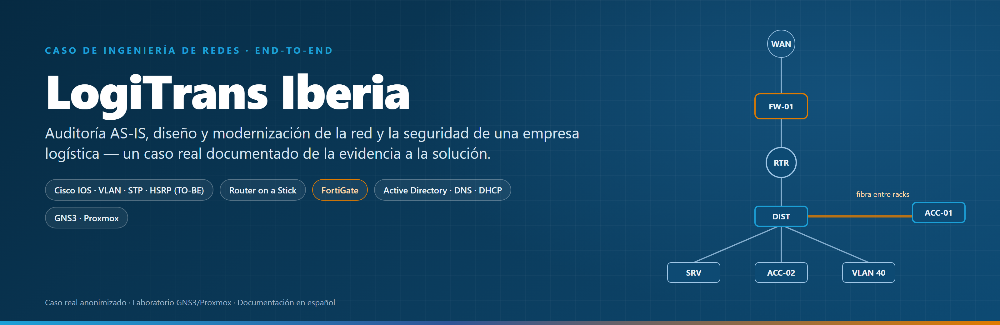
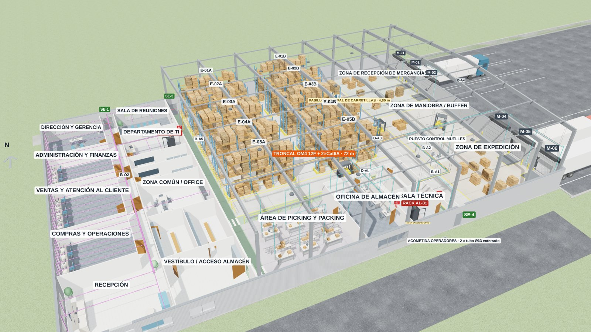
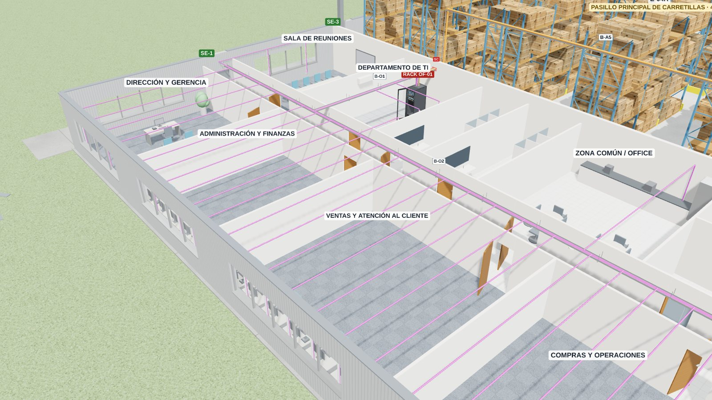
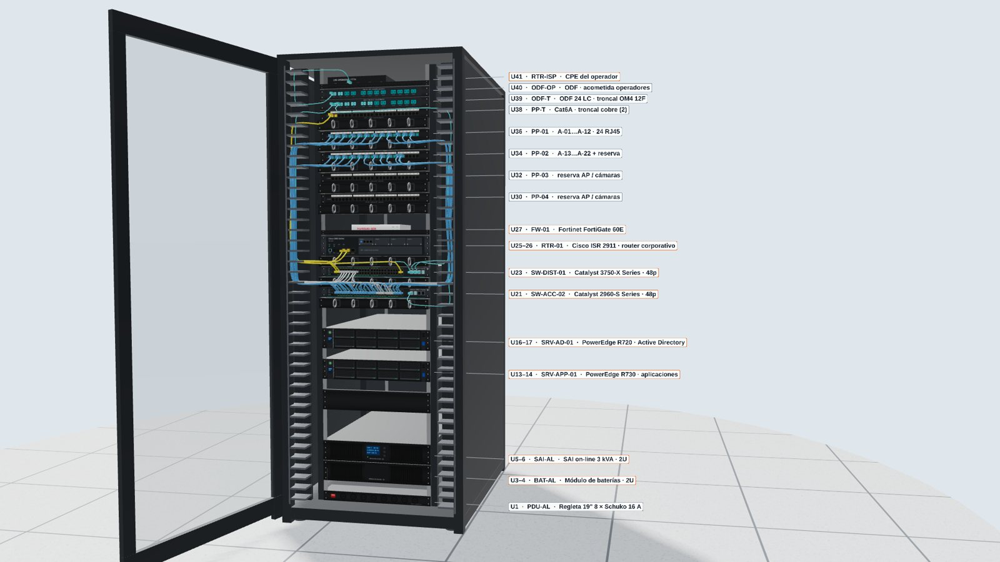
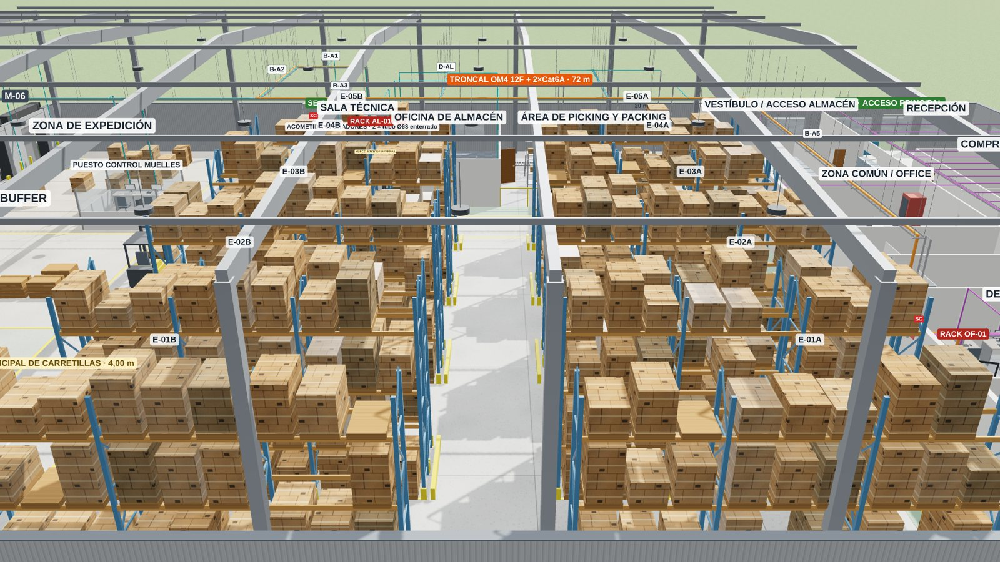
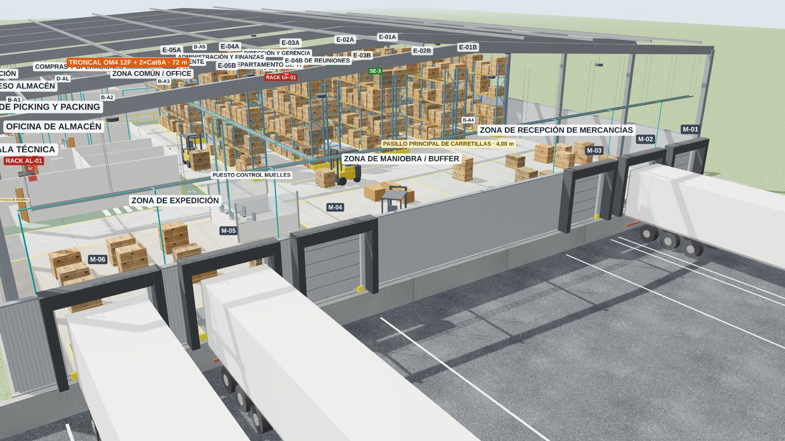

# LogiTrans Iberia · Modernización de red y seguridad

   

Este proyecto es un **caso completo de ingeniería de redes** basado en un trabajo real para una empresa logística, **anonimizado** por confidencialidad. Recorre todo el ciclo de un proyecto de infraestructura:

1. Entender el negocio.
2. Auditar la red existente (AS-IS).
3. Demostrar sus problemas con evidencia.
4. Diseñar la solución (TO-BE).
5. Migrar con plan de vuelta atrás.
6. Homologar con pruebas.

Cada tecnología entra en el proyecto solo cuando responde a un problema documentado, siguiendo siempre la misma secuencia:

> **problema → evidencia → impacto → solución justificada → implementación → prueba → comparación**

---

## Hoja de ruta

| Fase | Contenido | Estado |
|---|---|---|
| **0** | [La empresa y el problema](docs/FASE_0_EMPRESA.md) | ✅ Publicada |
| 1 | Levantamiento y diagnóstico AS-IS | Próximamente |
| 2 | Diseño TO-BE (HLD/LLD) | Planificada |
| 3 | Migración LAN: VLAN, STP, LACP y HSRP con MOP y *rollback* | Planificada |
| 4 | *Hardening* L2: Port Security, DHCP Snooping y DAI | Planificada |
| 5 | FortiGate e identidad | Planificada |
| 6 | Cableado estructurado y renovación física | Planificada · [avance: concepto 3D](#avance--concepto-3d-del-cableado-estructurado) |
| 7 | Wi-Fi empresarial | Planificada |
| 8 | Homologación, *Test Report* y entrega | Planificada |

## Fase 0 · La empresa y el problema

Una nave logística de 2.400 m² en Barcelona, con 60 empleados y 34 puestos informáticos, cuya operación (ERP, WMS, identidad y telefonía IP) depende de la red. La Fase 0 define el negocio, la sede, el alcance y los **9 problemas que se van a investigar**.

👉 [Leer la Fase 0 completa](docs/FASE_0_EMPRESA.md)

## Avance · Concepto 3D del cableado estructurado

**[▶ Abrir el modelo 3D](https://voespinal-code.github.io/network-security-projects/logitrans-iberia/3d/)**: funciona en el navegador, sin instalar nada.

El plano de cableado de la Fase 6 (LGT-F02-CAB-01) llevado a un modelo navegable:

- Nave de 60 × 40 m con oficinas, estanterías, picking, sala técnica y seis muelles.
- Bandejas a +2,70 m en oficinas y a +6,00 m en la nave, con su sección, longitud y ocupación.
- Troncal OM4 12F + 2 × Cat6A de 72 m entre el rack AL-01 (distribuidor de edificio) y OF-01 (distribuidor de planta).
- 54 tomas dobles (108 RJ45 Cat6A) con su recorrido hasta el rack.
- Racks AL-01 y OF-01 por dentro: ODF, paneles, switches, firewall, router, servidores y SAI, cada uno en su U.
- Clic en cualquier elemento para ver su ficha; vistas guardadas y recorrido automático.

| | |
|---|---|
|  |  |
|  |  |

> Es un concepto de diseño: alturas, recorridos y posición exacta de las tomas son hipótesis, y la electrónica montada en los racks es una propuesta (el plano solo reserva las U). El código está en [`3d/index.html`](3d/index.html).

## Stack

`Cisco IOS / IOL` · `Catalyst 3750-X / 2960-S` · `ISR 2911` · `FortiGate (FortiOS)` · `Windows Server 2022 — AD DS, DNS, DHCP` · `Debian/Ubuntu` · `GNS3` · `Proxmox VE` · `draw.io` · `three.js`

## Transparencia

- **LogiTrans Iberia es el nombre anonimizado de un cliente real.** El nombre de la empresa y los datos que podrían identificarla se han sustituido o generalizado; cifras, cotas y planos se presentan como referencia técnica, no como mediciones del sitio.
- Cada fase se publica cuando está lista, y los resultados de laboratorio solo cuando existen con su evidencia.
- Se separa siempre lo realizado en el entorno del cliente de las reproducciones y pruebas emuladas en GNS3/Proxmox: cada resultado indica su entorno, su evidencia y sus limitaciones.

---

**Autor:** Víctor Espinal
