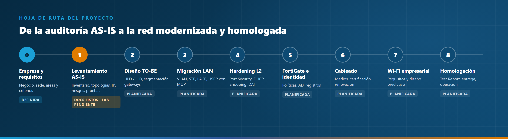

# LogiTrans Iberia · Modernización de red y seguridad

  

Este proyecto es un **caso completo de ingeniería de redes** sobre una empresa logística **ficticia**. Recorre todo el ciclo de un proyecto de infraestructura:

1. Entender el negocio.
2. Auditar la red existente (AS-IS).
3. Demostrar sus problemas con evidencia.
4. Diseñar la solución (TO-BE).
5. Migrar con plan de vuelta atrás.
6. Homologar con pruebas.

Cada tecnología entra en el proyecto solo cuando responde a un problema documentado, siguiendo siempre la misma secuencia:

> **problema → evidencia → impacto → solución justificada → implementación → prueba → comparación**

---

## Hoja de ruta

| Fase | Contenido | Estado |
|---|---|---|
| **0** | [La empresa y el problema](docs/FASE_0_EMPRESA.md) | ✅ Publicada |
| 1 | Levantamiento y diagnóstico AS-IS | Próximamente |
| 2 | Diseño TO-BE (HLD/LLD) | Planificada |
| 3 | Migración LAN: VLAN, STP, LACP y HSRP con MOP y *rollback* | Planificada |
| 4 | *Hardening* L2: Port Security, DHCP Snooping y DAI | Planificada |
| 5 | FortiGate e identidad | Planificada |
| 6 | Cableado estructurado y renovación física | Planificada |
| 7 | Wi-Fi empresarial | Planificada |
| 8 | Homologación, *Test Report* y entrega | Planificada |

## Fase 0 · La empresa y el problema

Una nave logística de 2.400 m² en Barcelona, con 60 empleados y 34 puestos informáticos, cuya operación (ERP, WMS, identidad y telefonía IP) depende de la red. La Fase 0 define el negocio, la sede, el alcance y los **9 problemas que se van a investigar**.

👉 [Leer la Fase 0 completa](docs/FASE_0_EMPRESA.md)

## Stack

`Cisco IOS / IOL` · `Catalyst 3750-X / 2960-S` · `ISR 2911` · `FortiGate (FortiOS)` · `Windows Server 2022 — AD DS, DNS, DHCP` · `Debian/Ubuntu` · `GNS3` · `Proxmox VE` · `draw.io`

## Transparencia

- **LogiTrans Iberia es una empresa ficticia.** El escenario, los modelos y las cifras son de diseño; las cotas del plano son hipótesis, no mediciones.
- Cada fase se publica cuando está lista, y los resultados de laboratorio solo cuando existen con su evidencia.
- Nada de este repositorio presenta experiencia en producción.

---

**Autor:** Víctor Espinal
