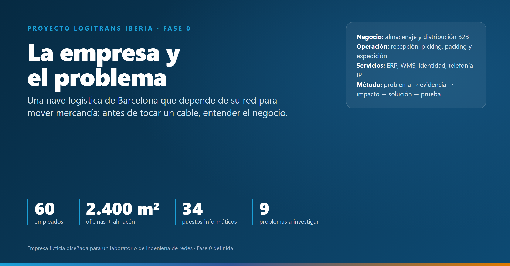
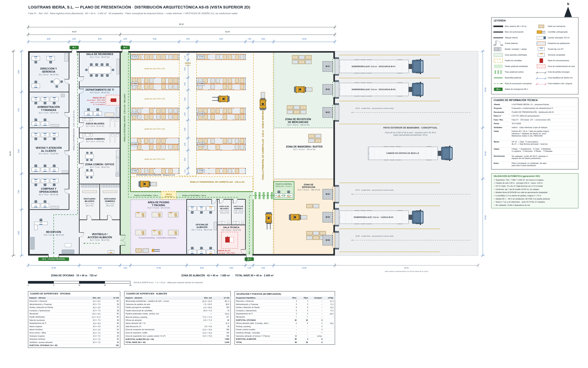

# Fase 0 · La empresa y el problema

> Antes de tocar un cable, hay que entender qué hace el negocio y qué se rompe si la red falla.

## 1. La empresa

**LogiTrans Iberia, S.L.** es una empresa *ficticia* de almacenamiento y distribución de mercancías para otras empresas (B2B). Su actividad consiste en recibir productos, almacenarlos, preparar pedidos y coordinar su expedición.

| Dato | Valor |
|---|---|
| Sede | Una nave logística en Barcelona |
| Plantilla | 60 empleados |
| Superficie | 2.400 m²: 720 m² de oficinas y 1.680 m² de almacén, en una planta de 60 × 40 m |
| Áreas | Dirección y Gerencia · Administración y Finanzas · Ventas y Atención al Cliente · Compras y Operaciones · Departamento de TI · Recepción · Almacén (recepción, almacenamiento, *picking*, *packing* y expedición) |
| Servicios críticos | ERP (gestión empresarial) · WMS (gestión de almacén) · identidad de usuarios · archivos · telefonía IP |

**La operación depende de la red.** Oficinas y almacén necesitan comunicarse en todo momento para consultar existencias, registrar movimientos y preparar pedidos. Si la red cae, se para el muelle.

## 2. La sede

**Oficinas (18 × 40 m).** Incluyen:

- Departamentos y sala de reuniones.
- Departamento de TI, con el **rack secundario OF-01**.
- Recepción, vestuarios y zona común.

**Almacén (42 × 40 m).** Incluye:

- Estanterías de paletización, *picking*/*packing* y recepción/expedición.
- Seis muelles.
- Oficina de almacén.
- Sala técnica, con el **rack principal AL-01**.

**Puestos informáticos.** Hay 34 para 60 personas: 26 fijos y 8 compartidos. *Que haya 60 empleados no implica 60 PC.*

Distribución, dimensiones de zona, muelles y estancias según el plano de presentación V03. El plano es conceptual: las cotas interiores son hipótesis de diseño, no mediciones reales.

## 3. Alcance del proyecto

**Incluido:**

- Levantamiento físico y lógico.
- Diagnóstico AS-IS.
- Diseño TO-BE.
- Migración en laboratorio.
- Seguridad, continuidad, pruebas, operación y documentación de entrega.

**Excluido:**

- Compras.
- Cambios en producción.

**Limitaciones:** la certificación física del cableado y las mediciones Wi-Fi reales requieren medios físicos. Si no se pueden hacer, se entrega el plan y se declara la limitación.

**Plataforma:** laboratorio híbrido GNS3 + Proxmox, con equivalencias virtuales documentadas frente al hardware del escenario.

## 4. Problemas que se van a investigar

Son **hipótesis por reproducir**, no incidencias ya observadas. Cada una tendrá evidencia inicial, solución justificada y prueba posterior.

| ID | Problema | Impacto en el negocio |
|---|---|---|
| P01 | Inventario y conexiones incompletos | Diagnóstico lento y riesgo de desconectar servicios |
| P02 | Segmentación insuficiente | Los usuarios alcanzan servicios innecesarios |
| P03 | Tráfico interno fuera del firewall | Las reglas no inspeccionan lo que no atraviesa el FortiGate |
| P04 | Router único de enrutamiento | Su caída corta las comunicaciones entre redes |
| P05 | Enlaces únicos | Una desconexión puede aislar las oficinas o el almacén |
| P06 | Riesgo de bucles y raíz STP inadecuada | Una tormenta de *broadcast* puede afectar a toda la LAN |
| P07 | Controles de acceso insuficientes | Equipos o DHCP no autorizados pueden alterar la red |
| P08 | Cambios sin recuperación ensayada | Una migración fallida prolonga la parada |
| P09 | Cableado y Wi-Fi sin validación | La capacidad y la cobertura no están acreditadas |

## 5. Cómo se trabaja

- **Método obligatorio:** problema → evidencia → impacto → solución → implementación → prueba → comparación.
- **Estados estrictos:**
  - *Definido* significa aprobado en el escenario.
  - *Implementado* significa aplicado en el laboratorio.
  - *Validado* significa probado con evidencia.
  - Un estado nunca se da por otro.
- **Fuente única de verdad:** un documento maestro versionado y un registro de decisiones (ID, alternativas, motivo y documentos afectados).
- **Entregables de nivel profesional:** HLD, LLD, MOP con *rollback*, *Test Plan* y *Test Report*.

---

⬅️ [Volver al README](../README.md) · ➡️ Fase 1: Levantamiento AS-IS (próximamente)
