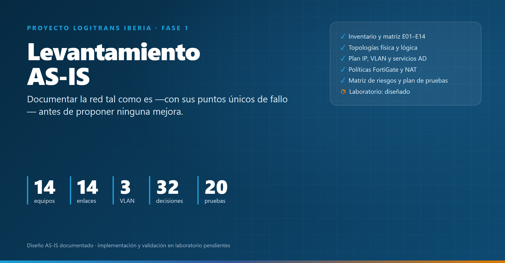
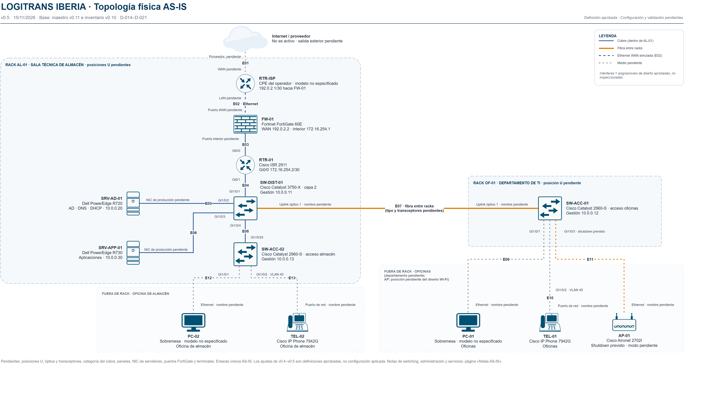
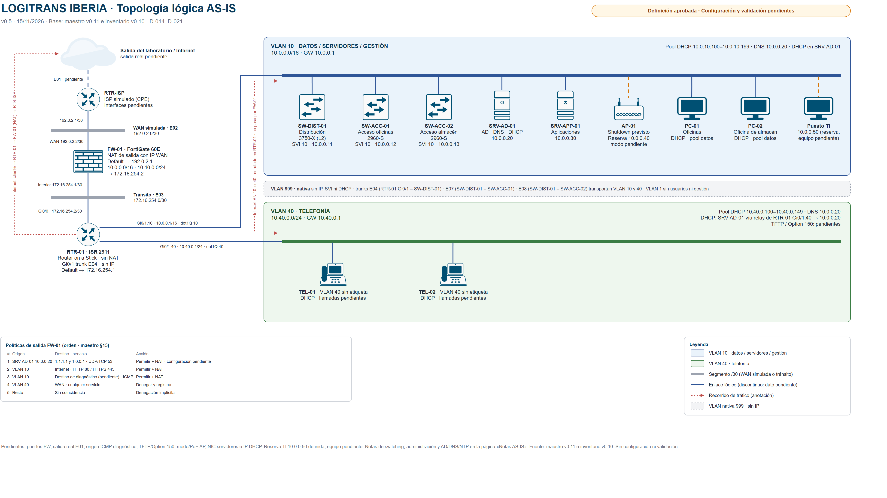

# Fase 1 · Levantamiento y diagnóstico AS-IS

> Documentar la red tal como es, con sus debilidades, antes de proponer ninguna mejora. Una debilidad del AS-IS no se corrige ahora: se mide como línea base.

La Fase 1 se cierra en dos partes:

| Parte | Contenido | Estado |
|---|---|---|
| **A · Documental** | Inventario, conexiones, topologías, plan IP, servicios, firewall, riesgos, plan de pruebas y diseño del laboratorio | ✅ Entregada para aceptación |
| **B · Laboratorio** | Montaje de la base AS-IS y ejecución de las 20 pruebas, con captura de cada resultado | Pendiente |

**Este documento no presenta resultados de laboratorio.** Todo lo que aparece aquí está definido, no probado: los resultados se publicarán en la parte B, también los que fallen.

---

## 1. Inventario

14 equipos del escenario, más los racks AL-01 (sala técnica del almacén) y OF-01 (oficinas).

| ID | Equipo del escenario | Función | Ubicación |
|---|---|---|---|
| RTR-ISP | Router del operador (Cisco 1941) tras la ONT | Entrega WAN | Rack AL-01 |
| FW-01 | Fortinet FortiGate 60E | Firewall perimetral y NAT | Rack AL-01 |
| RTR-01 | Cisco ISR 2911 | Routing inter-VLAN (*Router on a Stick*) | Rack AL-01 |
| SW-DIST-01 | Cisco Catalyst 3750-X | Distribución (capa 2) | Rack AL-01 |
| SW-ACC-01 | Cisco Catalyst 2960-S | Acceso de oficinas | Rack OF-01 |
| SW-ACC-02 | Cisco Catalyst 2960-S | Acceso de almacén | Rack AL-01 |
| SRV-AD-01 | Dell PowerEdge R720 | Active Directory, DNS y DHCP | Rack AL-01 |
| SRV-APP-01 | Dell PowerEdge R730 | Aplicaciones y registro del firewall | Rack AL-01 |
| PC-01 / PC-02 | Sobremesa SFF, Windows 10 Pro | Puestos de muestra | Oficinas / almacén |
| PC-TI-50 | Sobremesa SFF con RSAT | Único puesto de administración | Oficinas |
| TEL-01 / TEL-02 | Cisco IP Phone 7942G | Telefonía IP | Oficinas / almacén |
| AP-01 | Cisco Aironet 2702I | Wi-Fi (modo pendiente; puerto en *shutdown*) | Oficinas |

Cada ficha recoge identidad, ubicación, hardware, software, gestión, alimentación y trazabilidad, y cada dato lleva su fuente. Lo que no se pudo obtener figura como **limitación declarada** o **dato generalizado**: no se inventan series, MAC ni mediciones.

## 2. Topología física

> Planos v0.5. Aún no dibujan E14 (puesto de TI); la versión con E14 y la página del laboratorio llegan con la parte B. Donde difieran, manda la tabla de enlaces.

La matriz de conexiones tiene 14 enlaces (E01–E14):

| Enlace | Extremos | Medio | Función |
|---|---|---|---|
| E01 | Operador ↔ RTR-ISP | Fibra hasta la ONT, entrega en cobre | Entrega WAN |
| E02 | RTR-ISP ↔ FW-01 | Cobre dentro de AL-01 | Conexión exterior |
| E03 | FW-01 ↔ RTR-01 Gi0/0 | Cobre | Tránsito enrutado 172.16.254.0/30 |
| E04 | RTR-01 Gi0/1 ↔ SW-DIST-01 | Cobre | Trunk 802.1Q (*Router on a Stick*) |
| E05 / E06 | SW-DIST-01 ↔ SRV-AD-01 / SRV-APP-01 | Cobre | Acceso VLAN 10 |
| E07 | SW-DIST-01 ↔ SW-ACC-01 | Fibra OM3 entre racks | Trunk 10/40, nativa 999 |
| E08 | SW-DIST-01 ↔ SW-ACC-02 | Cobre | Trunk hacia el almacén |
| E09 / E12 | Acceso ↔ PC-01 / PC-02 | Pendiente | Acceso VLAN 10 |
| E10 / E13 | Acceso ↔ TEL-01 / TEL-02 | Pendiente | Acceso VLAN 40 |
| E11 | SW-ACC-01 ↔ AP-01 | Cobre, PoE+ | Wi-Fi (*shutdown* provisional) |
| E14 | SW-ACC-01 ↔ PC-TI-50 | Cobre | Acceso VLAN 10 del puesto de TI |

Un enlace virtual de laboratorio **no acredita** cobre ni fibra. El medio físico se documenta aparte y solo con evidencia.

## 3. Topología lógica y plan IP

| Segmento | VLAN | Subred | Gateway |
|---|---|---|---|
| Datos, servidores y gestión | 10 | 10.0.0.0/16 | 10.0.0.1 (ISR Gi0/1.10) |
| Telefonía | 40 | 10.40.0.0/24 | 10.40.0.1 (ISR Gi0/1.40) |
| Nativa sin uso | 999 | Sin IP, SVI ni usuarios | — |
| Tránsito FortiGate–ISR | — | 172.16.254.0/30 | — |
| WAN simulada | — | 192.0.2.0/30 (RFC 5737) | 192.0.2.1 |

**Switching:**

- VTP transparente y trunks estáticos 802.1Q que transportan las VLAN 10 y 40, con nativa 999.
- DTP desactivado donde corresponda (soporte por comprobar en la imagen).
- STP con el modo predeterminado de la imagen, **observado sin forzar la raíz**: ese será el punto de partida del problema P06.

**Hallazgo clave (P03):** el tráfico entre la VLAN 10 y la 40 se enruta en el ISR y **no atraviesa el FortiGate**. Tener VLAN separadas no equivale a estar aislado.

## 4. Servicios

| Servicio | Diseño AS-IS |
|---|---|
| Active Directory | Bosque `ad.logitrans.internal` (NetBIOS `LOGITRANS`) en SRV-AD-01 10.0.0.20 |
| DNS | Interno exclusivo en 10.0.0.20, con zonas integradas y actualizaciones seguras. Reenviadores 1.1.1.1 y 1.0.0.1 |
| DHCP | Datos 10.0.10.100–199 · Voz 10.40.0.100–149 mediante *relay* del ISR · Concesión de 8 días · Opciones 003, 006 y 015 |
| NTP | FortiGate como cliente externo y servidor interno · el PDC y los equipos Cisco y Linux se sincronizan con él · desfase máximo de 1 s para que las evidencias sean comparables |
| Administración | SSH v2 y HTTPS solo desde PC-TI-50 (10.0.0.50) · consola de recuperación antes de restringir |
| Registro | Syslog del FortiGate hacia SRV-APP-01, con retención de 90 días |

## 5. Firewall perimetral (FortiGate)

| # | Origen | Destino · servicio | Acción |
|---|---|---|---|
| 1 | SRV-AD-01 | 1.1.1.1 / 1.0.0.1 · DNS 53 | Permitir + NAT |
| 2 | VLAN 10 | Internet · HTTP/HTTPS | Permitir + NAT |
| 3 | VLAN 10 | 1.1.1.1 / 1.0.0.1 · ICMP de diagnóstico | Permitir + NAT |
| 4 | VLAN 40 | WAN · cualquier servicio | Denegar y registrar |
| 5 | Resto | — | Denegación implícita |

El diseño no tiene VIP ni VPN, y la administración desde la WAN está deshabilitada.

**Limitaciones declaradas:**

- Las reglas se basan en IP y puerto, no en la identidad del usuario.
- El puerto 443 puede transportar DNS sobre HTTPS.
- No hay inspección TLS ni IPS activos.

## 6. Riesgos y puntos únicos de fallo

La matriz de riesgos recoge 35 riesgos, cada uno con su probabilidad, impacto, responsable, medida y prueba asociada.

- **Puntos únicos de fallo:** RTR-ISP, FortiGate, ISR, distribución, accesos y enlaces E02/E03/E04/E07/E08, más un único servidor de AD/DNS/DHCP.
- **Medición:** cada uno se medirá por separado (alcance y tiempo de recuperación). **No se exige continuidad que el AS-IS no ofrece.**
- **Datos, servidores y gestión en la misma VLAN 10:** se acepta como línea base del problema P02.
- **Riesgos del laboratorio:** que el DHCP del laboratorio se escape a otra red, límites de licencia de la imagen del firewall, virtualización anidada, caducidad de las versiones de evaluación y copia coherente de AD.

## 7. Plan de pruebas base (TP-ASIS-01)

Son **20 pruebas**, todas **pendientes**, cada una con precondiciones, procedimiento, resultado esperado, evidencia y vuelta atrás:

- **Plataforma:** T01 host, imágenes y licencias · T02a aislamiento estructural · T02b fuga de DHCP con el ámbito activo.
- **Conexiones y switching:** T03 extremos de cada enlace · T04 VLAN y trunks · T05 STP observado.
- **Routing y servicios:** T06 gateways y rutas · T07 DHCP y *relay* · T08 AD y DNS · T09 recorrido inter-VLAN.
- **Firewall:** T10 WAN y NAT · T11 bloqueos y gestión · T18 registro persistente del firewall.
- **Línea base de problemas:** T12 fallos del AS-IS · T13 copia y restauración · T14 accesos y controles base.
- **Documentación y tiempo:** T15 trazabilidad · T16 NTP.
- **Puestos:** T17 puesto de TI · T19 segmento físico del laboratorio.

> Una prueba fallida significa que no se cumplió un criterio aprobado. Una prueba bloqueada significa que falta una precondición. Ninguna de las dos cierra la fase por sí sola.

## 8. Laboratorio

El escenario se reproduce en **GNS3 dentro de Proxmox VE**, sobre un host de laboratorio inventariado antes de configurar nada, en modo solo lectura.

| Escenario | Equivalente en el laboratorio |
|---|---|
| ISR 2911 / router del operador | IOL-L3 (GNS3) |
| Catalyst 3750-X / 2960-S | IOL-L2 (GNS3) |
| FortiGate 60E | FortiGate-VM dentro de GNS3 (versión y licencia por verificar) |
| SRV-AD-01 | VM con Windows Server 2025, niveles funcionales 2016 |
| SRV-APP-01 | VM con Ubuntu Server 24.04 |
| PC-01 / PC-TI-50 | VM unidas a GNS3 por un puente aislado por enlace |
| Teléfonos / AP | Clientes ligeros en la VLAN 40 / solo documental |

**Decisiones de diseño del laboratorio:**

- **Salida a Internet:** el router del operador emulado hace NAT hacia la red de salida del laboratorio, como lo haría la red del operador. Solo se traduce la dirección del firewall; todo lo demás se descarta y se registra.
- **Puentes sin puerto físico:** cada enlace entre GNS3 y una VM tiene su propio puente, sin salida a ninguna red real.
- **Segmento físico real:** un switch gestionable con equipos de verdad se conecta a un puerto de acceso de la VLAN 10. Va por una segunda tarjeta de red dedicada, sin conexión con ninguna otra red, y con *port-security* para detectar y contener equipos no previstos. Solo existe en el laboratorio, no en el cliente.
- **DHCP controlado:** el ámbito se activa solo dentro de la ventana de la prueba T02b, después de demostrar el aislamiento en T02a, con vuelta atrás inmediata si hay fuga.
- **Copia antes de tocar nada:** copia completa de las VM en un disco externo dedicado antes del primer cambio en el host.

Las equivalencias no reproducen el hardware: IOL no acredita óptica ni PoE, y un cliente ligero no demuestra que haya llamadas.

## 9. Qué falta: la parte B

1. Copia de seguridad del host y comprobación de la imagen y la licencia del firewall.
2. Montaje de la base AS-IS por etapas (S1–S10), cada una con su vuelta atrás.
3. Ejecución de las 20 pruebas con captura de cada resultado.
4. Informe de auditoría con los problemas reproducidos y su línea base.

## 10. Lo que esta fase enseña

- **El AS-IS se documenta, no se arregla.** Corregirlo a medias destruye la línea base contra la que se medirá la mejora.
- **"Definido" no es "funciona".** Separar lo propuesto, lo aprobado, lo implementado y lo verificado con evidencia evita afirmar lo que no se ha probado.
- **El laboratorio también se audita.** El inventario del host en solo lectura cambió decisiones: el almacenamiento real, la segunda tarjeta de red y la salida a Internet se rediseñaron con datos, no con suposiciones.

---

⬅️ [Fase 0: La empresa](FASE_0_EMPRESA.md) · [Volver al README](../README.md)
